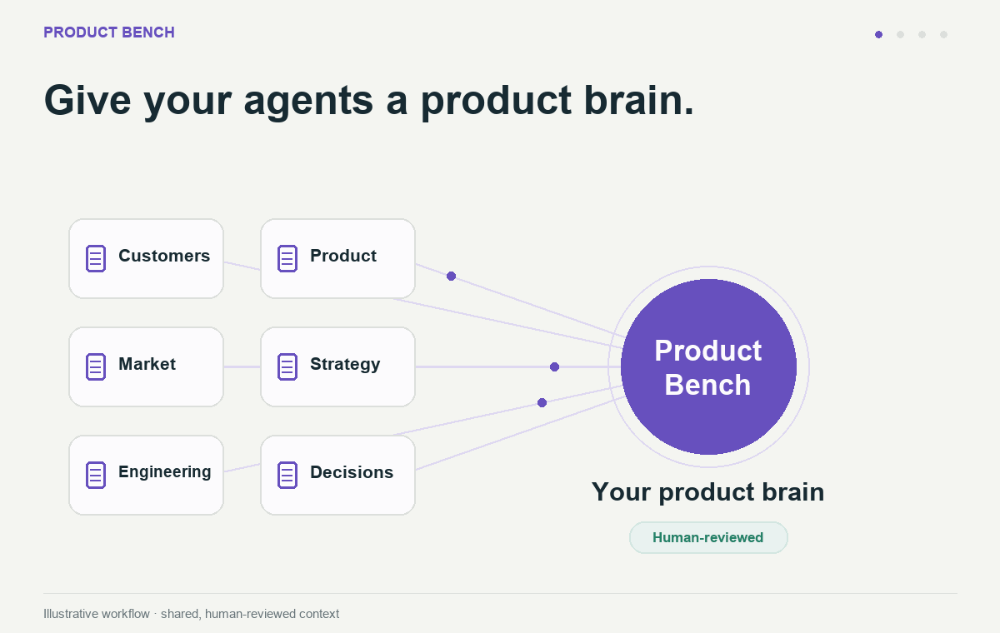

<picture>
  <source media="(prefers-color-scheme: dark)" srcset=".github/assets/banner-dark.svg">
  
</picture>

<a href="https://www.producthunt.com/products/product-bench-gtm-engines?embed=true&amp;utm_source=badge-featured&amp;utm_medium=badge&amp;utm_campaign=badge-product-bench-gtm-engines" target="_blank" rel="noopener noreferrer"></a>

[](.github/assets/demo.gif)

Your product brain. Shared knowledge, sharper product work. [View animated demo](.github/assets/demo.gif) · [Demo notes](docs/DEMO.md).


[](docs/FUNCTIONAL-TEST-COVERAGE.md)
[](docs/FUNCTIONAL-TEST-COVERAGE.md)

[CI checks](.github/workflows/ci.yml)

Product teams using Claude Code or Codex can end up repeating product facts and correcting drafts when decisions and evidence are scattered across files. Product Bench keeps reviewed context beside the repository and supplies workflows that turn it into cited drafts, explicit evidence gaps, and proposed context updates.

Product Bench is a Node.js CLI plus Markdown workflow and skill instructions. The CLI installs and maintains files in your project. Claude Code or Codex executes the workflows.

Install from a repository checkout using the steps below. npm is used for development checks and local packaging; this project does not offer an npm-registry installation command.

## Contents

- [What it does](#what-it-does) explains the tasks and outputs.
- [Quick start](#quick-start) installs into your project and starts context setup.
- [Offline demo](#offline-demo) checks installation and fictional analytics without an agent account.
- [Choosing a workflow](#choosing-a-workflow) maps inputs to commands.
- [Usage](#usage) covers drafting, context upkeep, analytics, optional imports, and installation maintenance.
- [Reference](#reference) links the complete CLI, workflow, source, and analytics contracts.
- [Before you rely on it](#before-you-rely-on-it) explains evidence, access, privacy, and preview limits.
- [Project](#project) covers compatibility, tests, contributions, security, and licenses.

## What it does

The bundle provides 37 workflows, 79 modes, and 24 bundled skills.

- `init`, `doctor`, `update`, and `uninstall` install both hosts and inspect managed-file health while preserving reviewed context and local edits. The [offline example](examples/inspect-install/) shows the direct result.
- `/pb-setup` and `/pb-onboard` build reviewed product context or orient a teammate, then help begin an eligible task. Setup covers all ten context areas before the handoff.
- `/pb-idea`, `/pb-hypothesis`, `/pb-scope-check`, `/pb-spec`, and related product workflows produce decision drafts, concise build contracts, research plans, prototypes, and roadmap proposals. Their findings support a human decision. They do not establish demand or ship a feature.
- `/pb-review-spec` saves independent lens findings and execution receipts through an authenticated host CLI. `/pb-evals` designs or reviews evaluation contracts using supplied traces and labels. Execution uses the team's chosen evaluation facility.
- `/pb-gtm`, `/pb-pricing`, `/pb-battlecard`, `/pb-sales-call-prep`, and `/pb-sales-doc` prepare buyer-specific plans, scripts, and documents from permitted proof. Document preview depends on available rendering tools.
- `/pb-blog`, `/pb-content-engine`, and the bundled SEO skills prepare sourced themes, drafts, audits, and refresh plans. Blog and LinkedIn writing use the imported Content Engine → Blog → Editorial Draft pipeline. Live SEO metrics require supplied evidence or working providers.
- `/pb-ai-citation-monitor` defines a stable buyer-question panel and reports mentions, citations, accuracy issues, and coverage from supplied observations. Its [synthetic report](docs/examples/citation-report.md) shows the decision aid. No collector or sanitizer is bundled.
- `/pb-compound`, `/pb-sync-context`, and `/pb-tech-sync` propose cited knowledge changes. The CLI stages observations and review state. The agent applies each approved context edit.
- `analytics`, `analytics-save`, `analytics-list`, `analytics-run`, and `analytics-dashboard` query fictional events or configured live adapters and rerun saved definitions. Live adapters require explicit configuration. See the [analytics contract](docs/ANALYTICS.md).
- `/pb-buzz` delegates community digests and brand reports to an optional explicitly configured Buzz repository. Importing requires Git access. Scans, credentials, delivery, and scheduling remain separate authorized actions.

### What it does not do

- It does not establish model quality, customer demand, or business outcomes from an installation check.
- It does not create missing tool access, provider credentials, or a universal evaluation runner.
- It does not publish drafts, post content, schedule work, or commit changes without authorization.
- It does not replace review of proposed context changes or sensitive exports.

## Quick start

You need Node.js 22+ and an authenticated Claude Code or Codex installation. The shell examples below use a POSIX shell.

Git is required for sharing context and importing optional engines. macOS has local test evidence, and CI is configured for Linux. Windows remains unverified.

Clone Product Bench, then replace `/absolute/path/to/your/project` with an **existing project directory**:

```sh
git clone https://github.com/tetriz-ai/product-bench.git
cd product-bench
product_bench_checkout="$PWD"
product_bench_target="/absolute/path/to/your/project"
node "$product_bench_checkout/product-bench.mjs" init --target "$product_bench_target" --brain-dir .product-bench
cd "$product_bench_target"
node .product-bench/runtime/product-bench.mjs doctor --target .
```

`init` previews the files and asks before applying. For an already reviewed noninteractive install, add `--yes`. `doctor` prints JSON, and `ready: true` means managed files are healthy.

Product context starts unfilled. Installation does not require `npm ci` or install an agent CLI.

Setup and agent workflows may send approved context and evidence to your host’s model provider or connected services. Approve source paths before use, and keep credentials and raw customer data outside shared context.

Start your chosen host **in the project directory**:

| Host | Start in the terminal | Start setup in the agent session |
|---|---|---|
| Claude Code | `claude` | `/pb-setup` |
| Codex | `codex` | Ask: `Read .codex/commands/pb-_preamble.md and follow .codex/commands/pb-setup.md.` |

Setup introduces the workflows, collects and reviews all ten context areas, and checks available sources and tools. Missing evidence stays explicit, and an area is deferred only when you request it. After building context, setup helps start your chosen task or leaves a launchpad.

Keep the reviewed context in your project's Git repository so teammates can use it. Open `<brain_dir>/GETTING-STARTED.md` in your project for the installed guide and its runtime links.

The source-browsable [command reference](payload/brain/COMMANDS.md) explains the next tasks. You can also use the [agent-assisted installation guide](INSTALL-AGENT.md).

Product workflows such as `pb-spec` are included. Finished Blog and LinkedIn writing additionally require the [Content Engine import](#import-the-content-pipeline), and community reports require the [Buzz import](#configure-and-run-buzz). Live analytics and connectors need their own provider access.

## Offline demo

To inspect the installation before adopting it, run from the Product Bench checkout. This demo also needs npm and `tar`:

```sh
node examples/inspect-install/run.mjs
```

It builds a local package, installs into a temporary directory, prints the following result, then removes the temporary files:

```text
Installation ready: true
Optional Buzz: not_configured
Fictional analytics: {"value":1,"numerator":3,"denominator":3,"fictional":true}
```

No account or network is needed. The demo checks local installation and a fictional activation-rate query. To run an agent workflow in your project, follow the quick start above.

## Choosing a workflow

| You have | Use | Example |
|---|---|---|
| A repository and product evidence | CLI installation, `/pb-setup` | [Quick start](#quick-start) |
| An idea, decision, or research question | Product workflows | [Draft a product decision](#draft-a-product-decision) |
| A spec or evaluation contract to assess | `/pb-review-spec`, `/pb-evals` | [Review and evaluate](#review-and-evaluate) |
| A buyer, deal, or editorial brief | GTM, sales, content, SEO | [Prepare commercial and editorial work](#prepare-commercial-and-editorial-work) |
| Supplied citation observations and buyer questions | `/pb-ai-citation-monitor` | [Monitor citations](#monitor-ai-citations) |
| New evidence or changed engineering facts | Context upkeep and source CLI | [Keep context current](#keep-context-current) |
| A metric or approved query | Analytics CLI/workflow | [Explore analytics](#explore-analytics) |
| Approved community topics and engine access | Optional `/pb-buzz` | [Configure and run Buzz](#configure-and-run-buzz) |
| A blog or LinkedIn writing brief | `/pb-blog`, `/pb-content-engine` with imported writing skills | [Import the content pipeline](#import-the-content-pipeline) |
| An installation to maintain or share | `update`, `uninstall`, normal Git | [Maintain and share](#maintain-and-share) |

There are two kinds of commands:

- **Terminal CLI actions**, such as `init`, `doctor`, and `analytics`, run with `node …/product-bench.mjs`. They install files or perform the documented local operations.
- **Agent workflows**, such as `pb-spec` and `pb-blog`, run inside your agent session. Claude Code exposes `.claude/commands/pb-*.md` as slash commands, which is the slash notation used below. In Codex, ask the agent to read `.codex/commands/pb-_preamble.md` and follow the matching `.codex/commands/pb-*.md` file.

## Usage

Unless a section says otherwise, terminal examples below run from your installed project directory and use the default `.product-bench` path. If you chose another brain directory, use the path recorded in `.product-bench-install.json`. Agent prompts run in the host session opened there.

### Draft a product decision

Bring a scoped problem, approved evidence, and an explicit decision. For example, ask the installed host:

```text
Follow pb-spec for a fictional contact-list import.
Scope: preserve completed rows and let the user retry unresolved rows.
Evidence: supplied fixture only, no observed customer outcome.
Include duplicate-retry, permission-loss, and partial-progress acceptance cases.
Keep unknown instrumentation, exposure, and baseline decisions explicit.
```

The expected artifact is an eight-section build contract with behavior, acceptance cases, metrics, constraints, and open decisions. The [complete synthetic example](docs/examples/spec.md) shows that shape. It is an illustrative draft, not a claim that this prompt was executed or that the feature works.

Related workflows include idea, hypothesis, scope-check, research, design, prototype, strategy, roadmap, and premortem. Use the [catalog](payload/brain/COMMANDS.md) for every mode's inputs and outputs.

### Review and evaluate

Spec review runs selected lenses in fresh authenticated host CLI sessions and saves findings and execution receipts. For a supplied `artifact.md`, from the installed repository:

```sh
node .product-bench/runtime/review-lenses.mjs --host claude --input artifact.md --out reviews --lenses functional,naive-reader --parallel 1
```

This command requires an authenticated Claude CLI and permission to invoke it. It is an integration example, and the offline demo does not run reviews. Use `--host codex` for Codex.

Empty or failed reviews leave readiness incomplete. The adapter's default lens set is narrower than `/pb-review-spec`'s complete explicit review plan.

`/pb-evals` takes output contracts, traces, and expert labels to propose or assess evaluators. The [synthetic evaluation plan](docs/examples/evals.md) shows presence rules, calibration, uncertainty, and hold decisions. Running a judge or claiming measured quality needs real execution evidence.

### Prepare commercial and editorial work

A sales document needs a buyer, deal stage, approved proof, and the requested next action. A launch or pricing plan needs a market question, scope, verified capabilities, and measurement definitions. The [synthetic battlecard](docs/examples/battlecard.md) demonstrates a buyer-specific output with explicit proof gaps.

After [importing the content pipeline](#import-the-content-pipeline), ask the installed host:

```text
Follow pb-blog for a fictional contact-list import recovery guide.
Audience: operations leads who retry interrupted CSV imports.
Approved facts: completed rows are preserved, and unresolved rows can be retried.
Use those facts only. Do not invent customer quotes, measured results or capabilities.
Save the finished draft and editorial review under the configured output directory.
```

The expected result is a finished draft from Editorial Draft with claim checks and a recorded editorial review. Missing supporting evidence remains explicit, and this example does not authorize publication.

Blog and Content Engine LinkedIn writing pass command presets and reviewed team voice to installed Editorial Draft. No separate Editorial Draft setup questionnaire is required. Its presets, eight reviewer contracts, polish resources and full Blog workflow belong to the imported Content Engine repository, rather than a second copy in Product Bench.

Research, claim checks, and theme preparation can continue when a required writing or rendering phase is unavailable.

Document and slide skills supply rendering mechanics and optional layouts. Team context or the task supplies fonts, palette, assets, and design choices. Neutral previews use system fonts and a slate palette.

### Monitor AI citations

Supply an approved buyer-question panel and observations with the canonical fields,
source citations, capture conditions, and missing-cell records. `/pb-ai-citation-monitor`
uses setup, record, report, or recalibrate mode to preserve panel versions and compute
eligible mention, citation, accuracy, and coverage rates.

The [synthetic report](docs/examples/citation-report.md) shows the output format.
Live collection is experimental and requires explicit authorization plus actual tool
access. No collector or sanitizer is bundled, and a reported change does not prove
that published content caused it.

### Keep context current

Each workflow reads its declared context and checks recorded freshness. `/pb-compound` proposes a specific learning with source and observation date. `/pb-sync-context` collects approved scopes and stages cited changes for review.

`/pb-tech-sync` reconciles authorized engineering evidence.

Use [source setup](docs/SOURCES.md) to register approved sources, pull observations,
and inspect pending proposals. Review the exact proposed diff, apply the approved
context edit, then record acceptance with `sync-decide --applied`. The `--applied` flag records your attestation of an applied edit, and the CLI does not apply it for you.

Complete and partial fetches are distinct. Failed or partial fetches leave the source unchecked and cannot advance a reviewed checkpoint. [Source setup](docs/SOURCES.md) defines scopes, pagination, deletion/reversion behavior, and deliberate 500-file/1-MiB boundaries.

### Explore analytics

From the installed repository:

```sh
node .product-bench/runtime/product-bench.mjs analytics --target . --metric activation_rate
```

The fixture returns `value: 1`, `numerator: 3`, `denominator: 3`, and `fictional: true`. It contains invented events. Live adapters require explicit BigQuery, PostgreSQL, or PostHog configuration and read-only access.

The package ships no credentials or customer data.

Save/list/run/dashboard actions persist reviewed definitions and expose fresh results. `--from`, `--to`, and `--account` filter the fixture only. Live SQL must express its own window and segment.

Dashboard metadata does not verify that live definitions use a common window. See [analytics setup](docs/ANALYTICS.md) and the seven [analytics guides](docs/analytics/).

### Import the content pipeline

Product Bench delegates writing to Content Engine, which bundles the complete Blog
procedure and Editorial Draft writing and editorial resources. Content Engine can also
run independently in Claude Code or Codex. Product Bench supplies your reviewed
context to that pipeline.

Importing requires Git, `python3` (Python 3.9+ for Content
Engine), and access to the chosen engine repository.

Set `content_source.repository` in `<brain_dir>/config.json` to the approved Content
Engine clone URL. `content_source.branch` defaults to `main`. Merge the following
key into the existing config, keeping its other settings:

```json
{
  "content_source": {
    "repository": "https://github.com/tetriz-ai/content-engine.git",
    "branch": "main"
  }
}
```

No engine repository is configured by default. Use the approved clone URL or an
authorized local clone path that your Git installation can access. Editorial Draft
needs no separate account, voice configuration or setup interview.

```sh
node .product-bench/runtime/product-bench.mjs content-install --target .
node .product-bench/runtime/product-bench.mjs content-install --target . --apply
```

Preview reads the configured branch head without installing. Apply resolves and
fetches the branch head, records its exact revision and links `content-engine`, `blog` and `editorial-draft`
into both hosts' skill catalogs. Ordinary runs do not fetch.

`doctor` checks local files and links. `update` previews and `update --apply` refreshes clean installed
imports to the configured branch head. Modified files, foreign skill directories
and rewritten upstream histories are preserved and reported.

Caller configuration,
credentials, signal banks, themes and drafts stay in the working repository.
Importing never runs a scan or writer, posts, schedules, or publishes.
The imported checkout stays Git-ignored, and each teammate imports it locally from the
shared source configuration.

On upgrade, unchanged managed copies of the former bundled Editorial Draft are retired.
Local customizations are preserved and may block the new links. Reconcile them with
the upstream skill before importing.

Source preparation remains possible without
the import, but delegated writing stays pending instead of silently changing engines.

### Configure and run Buzz

Configure `buzz_source.repository` in `<brain_dir>/config.json` with the approved engine clone URL supplied by its maintainer. `buzz_source.branch` defaults to `main`. No repository is configured by default.

Merge the following key into the existing config, keeping its other settings.
Importing requires Git, `python3`, and repository access. Consult
the chosen engine's README for its additional runtime and provider requirements.

```json
{
  "buzz_source": {
    "repository": "https://github.com/tetriz-ai/buzz-engine.git",
    "branch": "main"
  }
}
```

Use the approved clone URL or an authorized local clone path that your Git
installation can access. Existing imports retain their recorded source automatically.

From the installed repository:

```sh
node .product-bench/runtime/product-bench.mjs buzz-install --target .
node .product-bench/runtime/product-bench.mjs buzz-install --target . --apply
```

Without configuration, both commands return `not_configured` and the exact setup path. A configured import resolves the branch head into ignored `integrations/buzz-engine/`, records its commit, and links the native Codex skill. Each teammate imports it locally.

Importing never runs a scan, posts a digest, schedules work, or commits. `doctor` reports local status without fetching.

With a verified engine, use `/pb-buzz init`, then `/pb-buzz hn --dry-run --pdf`, or ask Codex to follow `pb-buzz`. The imported native skill is also available as `$buzz-engine`. Other modes are `ph`, `reddit`, `brands`, and `daily`.

Upstream files own configuration, drafting, state, and platform rules.

`update` previews upstream changes for an installed engine. `update --apply` advances a clean checkout on its configured branch, preserving local edits and refusing rewritten history. Fetch or compatibility failures retain the installed engine.

An absent optional engine is not installed by update. Normal Buzz runs use the installed revision without fetching.

### Maintain and share

Update your Product Bench source checkout to the version you want to adopt. Run the
following **from that source checkout**, replacing the target path with your
installed project's directory:

```sh
product_bench_target="/absolute/path/to/your/project"
node product-bench.mjs update --target "$product_bench_target"
node product-bench.mjs update --target "$product_bench_target" --apply
```

The JSON lists changed, removed, and skipped files. The [preservation example](examples/protect-team-edits/) checks the update boundary.

Running `update` from the installed runtime uses its current bundled payload. It does not download a newer Product Bench release.

Both forms can refresh already installed Buzz and Content Engine imports from their configured branches. They do not install absent engines.

Reviewed context, configuration, and source definitions are shared through normal Git. Commit approved context, then teammates pull the same files and run the quick-start installation locally. Runtime files, outputs, sync state, integrations, and machine-specific install metadata stay ignored.

Teammate installation preserves context and configuration. The legacy `share` action is an optional reviewed export, not required for team use.

To uninstall, run from the **installed project directory**:

```sh
node .product-bench/runtime/product-bench.mjs uninstall --target .
```

This prints removable/retained files and asks before removing unchanged managed files. It keeps context and local edits. Add `--yes` only for an already reviewed noninteractive removal.

## Reference

- [Complete CLI options and result/error rules](docs/CLI.md)
- [Workflow mode contracts](payload/brain/COMMANDS.md) and [detailed procedures](docs/workflows/)
- [Source registration, scoped pulls, proposals, and review checkpoints](docs/SOURCES.md)
- [Analytics providers, saved definitions, and filtering limits](docs/ANALYTICS.md)
- [Runnable offline examples](examples/README.md) and [synthetic artifacts](docs/examples/README.md)

The repo-root `.product-bench-install.json` records the actual brain directory. `.product-bench` is the default. Use the recorded path when it differs.

Drafts go beneath the configured `output_dir`. Missing evidence is labeled rather than invented.

CLI failures print a reason to standard error and exit nonzero. `doctor.ready` means managed-file health. It does not establish source permissions, context truth, analytics access, or workflow completeness.

## Before you rely on it

- Agent workflows, live SEO data, PDFs/slides, design inspection, and CRM access depend on authorized tools in the host session. Installing instructions does not prove those tools ran.
- Freshness checks validate recorded dates. They cannot establish that an unchanged fact is still true.
- Local CLI execution does not imply local model inference. Context and evidence used by an agent may reach its model provider or connected services.
- This is pre-1.0 software. All 79 modes and setup were functionally tested on both hosts with synthetic inputs. Output quality, authenticated live integrations, and Windows support remain outside that evidence, as described in the [release gates](RELEASE.md).

## Project

### Versioning and compatibility

The package version is `0.1.0`, a pre-1.0 version. The [changelog](CHANGELOG.md)
tracks this initial codebase under Unreleased; the version does not imply a
published package, Git tag, or GitHub release. Versions follow Semantic Versioning.

See the [release instructions](RELEASE.md) for contributor checks and GitHub releases.

Before v1.0, changes to existing CLI options, workflow modes, context schemas, host integration, or output formats may break compatibility in a minor release. Patch releases preserve those contracts.

Node.js 22 is the minimum.

CI is configured for Node.js 22, 24, and 26.

### Tests

Optional artifact rendering has a separate [offline verification procedure](docs/RENDERER-VERIFICATION.md).

The suite covers installation preservation, source-state checkpoints, fixture queries, fake-provider arguments/failures, privacy patterns, reviewer failures, and guarded Buzz and Content Engine imports. It does not establish live-provider or model quality.

Development checks need npm. The installation examples additionally need `tar`. Run from this checkout:

```sh
npm ci
npm run check
npm test
npm run test:install
node scripts/run-examples.mjs
```

`workflows.mjs`, `details.mjs`, and `docs/workflows/` are canonical. Regenerate with `npm run generate`. Do not edit generated command bodies.

Edit `payload/commands/pb-setup.md` and `payload/commands/pb-_preamble.md` directly. These hand-maintained files are excluded from generation.

CI also runs npm vulnerability checks and secret scans of the shipping tree and repository history. A dedicated job installs the Python/Chromium prerequisites and verifies actual renderer artifacts and prototype-browser behavior. Weekly checks and duplicate-run cancellation follow the same configuration.

See [testing](docs/TESTING.md) for coverage boundaries and opt-in real Claude Code/Codex workflow checks.

### Contributions, security, and license

- Follow [contributing](CONTRIBUTING.md), the [code of conduct](CODE_OF_CONDUCT.md), and [changelog](CHANGELOG.md).
- Follow [security reporting](SECURITY.md).
- Project-owned material uses the [MIT License](LICENSE). Bundled third-party material retains the terms in [NOTICE](NOTICE) and [third-party notices](THIRD-PARTY-NOTICES.md).

Optional renderer dependencies retain [Python-2.0 and PSF-2.0 license terms](THIRD-PARTY-NOTICES.md#optional-python-renderers).

See [contributors](CONTRIBUTORS.md).

### Bundled skills and attribution

The 24 bundled skills include 20 SEO skills, `grill-me`, `plain-english`, visual document creation, and slide rendering. Skill instructions and local resources install automatically on both hosts. Their execution still follows each task's evidence and tool requirements.

The 20 `seo-*` skills are third-party marketplace skills by Aaron He Zhu from the [SEO & GEO Skills Library](https://github.com/aaron-he-zhu/seo-geo-claude-skills), under Apache-2.0. The CITE and CORE-EEAT shared references also retain their original MIT notices. See the [full upstream license](payload/skills/seo-memory-management/upstream-shared/LICENSE), [benchmark notices](THIRD-PARTY-NOTICES.md#cite-and-core-eeat-benchmark-references), and [version/file inventory](docs/THIRD-PARTY-PROVENANCE.json).

Copyright 2026 Workloom Solutions Private Limited
